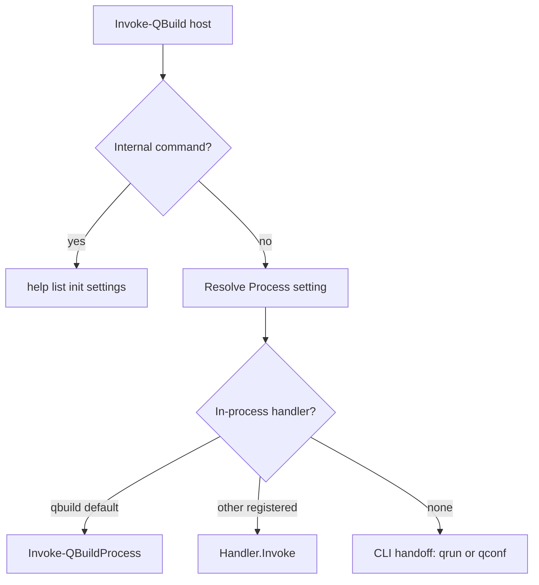

# Make qbuild the default process handler

Yes. `qbuild` is still the host and the only in-process executor. `qrun` and `qconf` are external commands selected by `_settings.process` and invoked with path-only `-map`. The uncommitted tests in `test/qbuild-process.tests.ps1` already specify the missing piece: a registry whose default handler is `qbuild`, plus dispatch of other in-process handlers without `_sourceFile`.

`qrun` and `qconf` stay external. They keep their own commands, `!complete`, and list formatting. Moving them in-process is a later change.

## Registry

Add a private module registry in `functions/custom-process.ps1`:

- `Register-ConfigMapProcess -Name -Invoke -GetDynamicParam -WriteListEntry`
- `Get-ConfigMapProcessHandler -Name` (ordinal-ignore-case)
- `Unregister-ConfigMapProcess -Name`

Each handler is an object with `Name`, `Invoke`, `GetDynamicParam`, and `WriteListEntry`. Do not export these; `test/public-api.tests.ps1` locks the public command list. Tests already call them through `InModuleScope`.

## Default qbuild handler

Move the current default body of `functions/qbuild.ps1` (target lookup, bound-parameter filtering, plugin hook, parent-without-exec prompt, `Invoke-EntryWrapper`) into `Invoke-QBuildProcess`. Move the `Get-EntryDynamicParam` branch into `Get-QBuildProcessDynamicParam`.

Register both at the bottom of `qbuild.ps1`, with `WriteListEntry` left unset. Missing `_settings.process` still resolves to `qbuild` via `functions/settings.ps1` (`Process = 'qbuild'`), so explicit `process = 'qbuild'` and the implicit default take the same handler.

The host passes one context object. `Entry` is required by the probe test. The default handler also needs the merged map, user map, map argument, command, invocation, operation context, bound parameters, and passthrough arguments (`ProcessAction`, `ProcessValue`, `RemainingArguments`).

Internal commands (`help`, `list`, `!init`, `!settings`, `!describe`, `!cache`) stay on the host. They are not process entries.

## Dispatch

Replace the two `Process -ne 'qbuild'` branches in `Invoke-QBuild`:

- **Run:** if a handler has `Invoke`, call it and return. Otherwise keep `ConvertTo-ConfigMapProcessSplat` plus `Invoke-ConfigMapProcessCli`, including the existing error when the map has no `_sourceFile`.
- **dynamicparam:** if a handler has `GetDynamicParam`, call it. Otherwise keep `New-ConfigMapProcessDynamicParam`.
- **Completion and process-name discovery** in `custom-process.ps1`: skip `!complete` for names that have an in-process handler. `qbuild` entries stay on `Get-EntryCompletion`. External processes still use `!complete`.
- **List** in `functions/help.ps1`: if the handler has `WriteListEntry`, call it. If the handler exists and `WriteListEntry` is empty, keep the normal command line. If there is no handler, keep the current `qrun`/`qconf` `list` CLI forward.

Guard CLI handoff so a missing `qbuild` handler cannot call `Invoke-QBuild` again.

## Verification

The new tests are the contract and should fail before the registry exists:

- explicit `process = 'qbuild'` runs the entry
- `Get-ConfigMapProcessHandler -Name qbuild` returns `Invoke` and `GetDynamicParam`, and no `WriteListEntry`
- a registered `qprobe` handler runs from an in-memory map and does not run `exec`

Then run the related Pester files: `qbuild-process.tests.ps1`, `qbuild-qconf.tests.ps1`, `qbuild.tests.ps1`, and `public-api.tests.ps1`.
