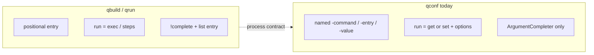

# qconf as a process type (under qbuild)

Normative process CLI contract: [`process-cli.md`](../process-cli.md).
This plan applies that contract to **qconf**, the same way **qrun** was wired.

## Goal

Allow `.build.map.ps1` entries to declare `process = "qconf"` so that:

```text
qbuild storage              →  & qconf -map <file> storage          # default: get
qbuild storage -value local →  & qconf -map <file> storage -value local  # set
qbuild list                 →  & qconf -map <file> list storage     # per-entry summary
```

qbuild stays process-agnostic: path-only `-map`, discover params via `!complete`,
forward opaque args via `&`. No hardcoding of `-value` / get / set on `Invoke-QBuild`.

## Comparison today



| Dimension | qbuild | qrun | qconf (today) |
|-----------|--------|------|---------------|
| Default map | `.build.map.ps1` | `.process.map.ps1` | `.configuration.map.ps1` |
| Language | `build` | `build` (process maps) | `conf` |
| Primary arg | positional `<entry>` | positional `<entry>` | named triad: `-command`, `-entry`, `-value` |
| “Run” meaning | invoke `exec` | run steps + durable state | **get** (read) or **set** (write option) |
| List | `Write-MapHelp` + process `list <entry>` | `list` / `list <entry>` status tree | `list` in ValidateSet but **unimplemented** |
| Discovery | map walk + process `!complete` | `!complete -word` / `-params` | ArgumentCompleter attributes only |
| Opaque params | via `!complete` | Follow/Force/Status/Reset + step params | dynparams from `"$entry.$command"` |
| Process plugin | built-in | none (command on PATH) | **none** |
| Works with qbuild splat `{map, entry}` | yes | yes | **no** — `$command` null → throw |

### What “run entry” means for each

| Tool | Bare `<entry>` | With extra args |
|------|----------------|-----------------|
| qbuild | execute `exec` | script params |
| qrun | run all pending steps | `-Force`, `.step`, `-Follow`, … |
| qconf | **undefined today** without `-command` | `-command get\|set` + `-value` (option **key**, not raw payload) |

Conf entries are option-keyed get/set (see `samples/_default/.configuration.map.ps1`):
`options` → named presets; `get` / `set` / optional `validate`.

## Gaps vs process CLI contract

| Contract piece | qrun | qconf today | Work |
|----------------|------|-------------|------|
| Positional `<entry>` | yes | no (command steals first positional) | Reshape CLI |
| Path-only `-map` | yes | path **or** hashtable | Keep hashtable for standalone tests; require path when delegated |
| Default run on bare entry | run process | throws / needs `-command` | Default verb = **get** |
| `list <entry>` | status tree | missing | Implement (Active / Value / Options) |
| `!complete -word` | yes | no | Add |
| `!complete -params` | yes | no | Add (`value` + set dynparams) |
| Load conf semantics from `.build.map.ps1` | n/a | language always `"conf"` + default conf map | Accept build map path; resolve with conf reserved keys |

`Resolve-ConfigMapProcessRoot` already walks **build** maps for `process=…`. Conf-shaped
leaves live in `.build.map.ps1` with `process = "qconf"` (same pattern as qrun).

## Proposed UX

### Map shape (in `.build.map.ps1`)

```powershell
[ordered]@{
    build = { param($Configuration = 'Debug') dotnet build -c $Configuration }

    storage = @{
        process     = 'qconf'
        description = 'App storage endpoint'
        options     = {
            @{
                local = @{ 'Storage:BaseUrl' = 'https://127.0.0.1:10000/devstoreaccount1' }
                prod  = @{ 'Storage:BaseUrl' = 'https://prod.example' }
            }
        }
        get = { param($ctx, $options) /* read active config */ }
        set = { param($ctx, $key, $value) /* apply option payload */ }
        validate = { param($path, $value, $key) $true }
    }
}
```

Standalone `.configuration.map.ps1` + direct `qconf` remain supported for existing workflows.

### Invocation mapping

| User intent | Via qbuild | `&` handoff |
|-------------|------------|-------------|
| Read current | `qbuild storage` | `qconf -map f storage` → **get** |
| Write option | `qbuild storage -value local` | `qconf -map f storage -value local` → **set** |
| List row | `qbuild list` | `qconf -map f list storage` |
| Complete params | tab after entry | `qconf -map f !complete -params -entry storage` |
| Complete tokens | tab on entry | map walk and/or `!complete -word` |

Optional sugar (process-owned, not qbuild): positional option key
`qconf storage local` → set, if RemainingArguments supplies the key when `-value` omitted.

### Default verb decision

**Bare entry = get** (safe, idempotent). Set requires explicit `-value` (or process-owned
positional). Never default bare entry to set.

## qconf CLI reshape (required for contract)

Align with qrun’s entry-token model while keeping get/set semantics:

```text
qconf [-map <path>] <entry> [-value <optionKey>] [opaque…]   # get (default) or set if -value
qconf [-map <path>] list [<entry>]
qconf [-map <path>] !complete -word <prefix> [-entry …]
qconf [-map <path>] !complete -params -entry <entry>
qconf help | !init
```

### Compatibility

| Legacy | Keep? |
|--------|-------|
| `qconf -command get -entry storage` | Yes during transition (map `-command` if present) |
| `qconf -command set -entry storage -value local` | Yes |
| `qconf -map $hashtable …` | Yes for standalone / unit tests |
| ValidateSet `list`/`init` as `-command` | Prefer entry tokens `list` / `!init` (qrun style); deprecate dead `-command list` |

### `list <entry>` output

Human-oriented summary of one conf entry (not process state):

- Path / description
- Active option key
- Current Value (compact)
- Options keys
- IsValid when validate exists

Reuse `ConvertTo-MapResult` / get path; print via Write-Host (same host style as
`Write-ProcessStatus` for qrun). Full-map `qconf list` (no entry) can keep
`Write-MapHelp -language conf`.

### `!complete -params`

Stdout one name per line, e.g.:

```text
value
```

Plus any extra set-script parameters after the reserved `ctx`/`key`/`value` skip
(today’s `skip=3` for set dynparams). qbuild does not need to know that `-value`
means “option key”.

### Option-value completion

`-value <Tab>` stays **inside qconf** (ArgumentCompleter on `-value`, or richer
`!complete` later). qbuild only exposes the param name via `!complete -params`;
it does not complete option keys itself.

## qbuild side

No qbuild special-cases for conf beyond existing process delegation:

1. `Resolve-ConfigMapProcessRoot` sees `process = 'qconf'`
2. Dynparam → `Get-ConfigMapProcessCompleteParams` / `New-ConfigMapProcessDynamicParam`
3. Invoke → `ConvertTo-ConfigMapProcessSplat` + `Invoke-ConfigMapProcessCli`
4. List → `& qconf -map <file> list <entry>` (already in `Write-MapHelp` for non-qbuild process)

No process plugin required — `Get-Command qconf` resolving is enough.

## Language / map loading

When qconf is invoked with `-map` pointing at a `.build.map.ps1`:

- Load via `Import-ConfigMap` (already format-agnostic).
- Resolve entries with **conf** reserved-key semantics (`get`/`set`/`options` not treated as child commands).
- Do not require `.configuration.map.ps1` when `-map` is explicit.

When run standalone without `-map`, keep fallback `./.configuration.map.ps1`.

## Risks and open questions

1. **`-value` naming** — Today it is an option **key**. Keep name for compatibility; document clearly. Alternate `-option` alias later if needed.
2. **`Invoke-Set` call site** — `qconf.ps1` passes `-ordered` to `Invoke-Set`, but `Invoke-Set` only accepts `$entry, $bound`. Fix as part of set-via-process work; verify with set-focused tests.
3. **Mixing without `process=`** — A get/set leaf in a build map without `process=qconf` will be treated as a normal build entry (expects `exec`) and fail. Always set `process = 'qconf'`.
4. **Include / share maps** — `#include` of conf maps into build maps is a separate concern; v1 is inline conf-shaped entries in the build map (or copy path).
5. **get-all** — Today `qconf -command get` with no entry gets all keys. Under positional entry model, that stays `qconf` with no entry → help/list, or an explicit `qconf get` / `qconf !get-all` if we still want it. Prefer not to overload bare `qconf`.
6. **Return objects** — `get` writes PSCustomObjects to the pipeline. qbuild currently `| Out-Null`s process CLI results. For `qbuild storage` (get), consider **not** discarding pipeline output so scripts can capture Active/Value. (qrun is host-only today.)

## Implementation order

1. **Tests first (file-backed)** — `test/qbuild-qconf.tests.ps1` (or extend process tests):
   - default qbuild entry still runs beside `process=qconf`
   - `qbuild storage` → get markers / Active
   - `qbuild storage -value local` → set side effect
   - `qbuild list` row shows options / active
   - smoke sample map
2. **qconf contract surface** — positional entry, default get, `-value` set, `list <entry>`, `!complete`, keep legacy `-command` where cheap.
3. **Fix set path** — `Invoke-Set` / ordered binding; add regression tests.
4. **Wire sample** — e.g. `samples/process-mixed` or `samples/configure` hybrid with `process=qconf`.
5. **Optional** `process-qconf` plugin stub (metadata only).
6. **Docs** — update CLAUDE.md / sample README; link from the process CLI docs as a second process.

## Out of scope (v1)

- qbuild hardcoding `-value` / get / set
- Replacing standalone `.configuration.map.ps1` workflows
- `!state` for conf (no durable process state)
- Auto-detecting conf-shaped entries without `process=qconf`
- Full option-key completion through qbuild’s own completer (stays on qconf)

## Reference mapping (target)

| qbuild action | `&` argv |
|---------------|----------|
| `qbuild -map f storage` | `qconf -map f storage` (get) |
| `qbuild -map f storage -value local` | `qconf -map f storage -value local` (set) |
| `qbuild list` (storage row) | `qconf -map f list storage` |
| autocomplete params | `qconf -map f !complete -params -entry storage` |

## Todos

- [ ] Keep this plan as the normative reference for qconf-as-process
- [ ] Add file-backed `qbuild`↔`qconf` behavioral tests (red first or with reshape)
- [ ] Reshape qconf to process CLI contract (entry-first, default get, list, !complete)
- [ ] Fix set invocation; verify option-key `-value` end-to-end via qbuild
- [ ] Sample + docs; optional `process-qconf` plugin metadata
