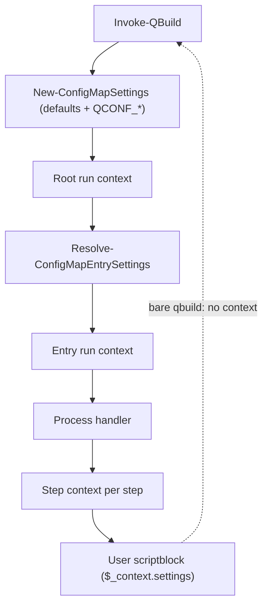

# Pass settings in a run context instead of module state

Effective settings live in one module variable, `$script:ConfigMapSettings` (`functions/settings.ps1`). `Invoke-WithEntrySettings` stacks a scope on top of whatever is current, runs a scriptblock, and restores the previous value. Settings therefore follow the dynamic call stack, not the map.

That leaks into nested runs. A `qbuild` called from inside a running entry starts from the caller's scope and inherits every setting the target map does not override, including `process`.

## Motivating bug

```powershell
[ordered]@{
    "outer" = [ordered]@{
        _settings = @{ process = "steps" }
        "step1" = @{
            exec  = { Write-Host "exec ran" }
            check = { qbuild inner; $true }
        }
    }
    "inner" = { Write-Host "inner ran" }
}
```

- `qbuild inner` works.
- `qbuild outer -check` fails: `MISSING step1 (Process 'inner' has no steps.)`
- Calling `qbuild inner` from the step's `exec` fails the same way: `FAIL step1 — Process 'inner' has no steps.`

`inner` has no `_settings.process`, so it keeps the caller's `steps` and is dispatched to the steps handler. The same leak applies to `UseWorkDir`, `ForceCheck`, `Concurrently`, `TmuxAutoWindow`, `DiscoveryCache*` and `Debug`.

## Current state

Readers of the global (all module-internal):

| Setting | Reader |
|---|---|
| `UseWorkDir` | `functions/invoke-entry.ps1` (`Invoke-EntryCommand`) |
| `ForceCheck` | `handlers/qrun/qrun.ps1` |
| `Debug` | `handlers/qconf/qconf.ps1` |
| `DiscoveryCache`, `DiscoveryCacheLocation` | `functions/discovery-cache.ps1` |
| `Concurrently` | `plugins/plugin-concurrently/concurrently.ps1` |
| `TmuxAutoWindow` | `plugins/plugin-tmux/tmux.ps1`, `_plugin.ps1` |
| all | `!settings` internal command |

Writers:

- `Invoke-WithEntrySettings`: `handlers/exec/exec.ps1`, `handlers/qrun/qrun.ps1`, `handlers/qrun/process-state.ps1`, `handlers/qconf/qconf.ps1`, `functions/invoke-entry.ps1`, `plugins/plugin-tmux/_plugin.ps1`.
- `Enter-ConfigMapSettingsScope`: four sites in `functions/discovery-cache.ps1`, wrapping map loading.

`Get-ConfigMapSettings`, `Enter-ConfigMapSettingsScope` and `Invoke-WithEntrySettings` are not exported. The public contract is the `_settings` schema, the `QCONF_*` environment variables and the `!settings` output; none of these change.

Context objects that already exist and overlap:

- `OperationContext`: include and dependency caches for one operation.
- `New-ConfigMapProcessContext`: handler input (`Map`, `Entry`, `BoundParameters`, passthrough arguments, `OperationContext`).
- Plugin hook contexts, built ad hoc in `Invoke-EntryWrapper` and `exec.ps1`.
- `$_context` for user scriptblocks: `self`, `base`, `workDir`, `mapDir`.

## Design

One run context per `qbuild` invocation. Each entry gets a child context. No module variable holds settings.

```powershell
@{
    Settings  = <ConfigMap.Settings>  # base, then map _settings, then ancestors, then the entry
    Operation = <OperationContext>    # caches; shared by reference between parent and child
    Map       = ...
    MapPath   = ...
    EntryKey  = ...
    Entry     = ...
    WorkDir   = ...
    MapDir    = ...
}
```



### Pure settings resolution

`Resolve-ConfigMapEntrySettings -Base -Map -EntryKey -Entry [-OperationContext]` returns a settings object and touches no state. It applies the map's `_settings`, the ancestor chain from `Find-ConfigMapAncestorSettings`, and the entry's own `_settings` on top of `-Base`, in the same order as today. `Get-ConfigMapSettingsForPath` (completion, help, list, `!settings`) becomes a wrapper around it.

### Child contexts replace scopes

```powershell
# before
Invoke-WithEntrySettings -Map $map -EntryKey $key -Entry $entry -OperationContext $op -ScriptBlock { ... }

# after
$child = New-ConfigMapEntryContext -Parent $context -EntryKey $key -Entry $entry
...  # pass $child explicitly
```

Nothing is mutated, so no `try`/`finally` is needed. A child's settings are resolved from the parent's base settings and the map, not from the parent's resolved settings, so a sibling or nested entry never sees another entry's `_settings`.

### Readers take settings explicitly

`Test-ConfigMapFeatureEnabled` and `Get-ConfigMapSetting` gain a mandatory `-Settings` parameter. Handlers read from `$Context.Settings`. Plugin hook contexts carry `Settings` and the run context instead of copied fields.

### User scriptblocks

`$_context.settings` exposes a read-only copy of the entry's effective settings. This is new, opt-in data; existing `$_context` keys stay.

### Nested qbuild

A nested `qbuild inner` inside a scriptblock receives no context. It starts from base settings and the target map's own `_settings`, which fixes the motivating bug. Nothing is inherited from the caller.

### Consolidation

- `OperationContext` becomes the `Operation` field of the run context.
- `New-ConfigMapProcessContext` carries the run context instead of `OperationContext`.
- Plugin hook contexts are built from the run context.

## Hard parts

- **Discovery cache.** It enters scopes around map loading, so settings must be threaded through the import path, including the `$script:ImportConfigMap` scriptblock. This is the most invasive step.
- **`exec` arrays.** `Invoke-EntryCommand` passes a sub-entry as `-Map` and relies on the parent's scope still being active. It needs the parent context instead.
- **`Invoke-EntryCommand` is exported.** It gets an optional `-Context`. Without one it resolves settings from the entry alone, which matches the nested-qbuild behavior.
- **Tests that reset the global.** `concurrently.tests.ps1`, `discovery-cache.tests.ps1` and `qbuild-cache.tests.ps1` call `Update-ConfigMapSettings` to pick up changed `QCONF_*` variables. Once base settings are built per invocation, these calls become unnecessary and are removed with the global.

## Migration

Each step keeps the suite green.

1. **Red.** Pester regression test: nested `qbuild` from a steps `check` and from a steps `exec` runs the target with `process = exec`. Confirm it fails with `has no steps`.
2. Add `Resolve-ConfigMapEntrySettings`; route `Get-ConfigMapSettingsForPath` through it.
3. Build the run context in `Invoke-QBuild` and pass it to handlers. Replace `Invoke-WithEntrySettings` one handler at a time: exec, qrun, qconf, then `invoke-entry` and the tmux plugin. The regression test goes green here.
4. Convert readers and plugins to `-Settings`.
5. Thread settings through the discovery cache and import path.
6. Delete `$script:ConfigMapSettings`, `Update-ConfigMapSettings`, `Enter/Exit-ConfigMapSettingsScope(s)`, `Enter-ConfigMapAncestorSettingsScopes` and `Invoke-WithEntrySettings`.

Steps 1–3 fix the bug and can ship alone. Steps 4–6 finish the cleanup.

## Decisions

- **No settings reach nested runs.** A nested `qbuild` always starts from base settings (defaults + `QCONF_*`) and the target map. There is no `-Context` passthrough; to change a nested run's settings, set `_settings` in its map or a `QCONF_*` variable.
- **`$_context.settings` is a read-only copy.** Scriptblocks get a snapshot; changing it does not affect the run context or later steps.
- **Standalone `qrun`/`qconf` are out of scope.** They are legacy; the external CLI handoff keeps its current behavior and does not receive the context.
