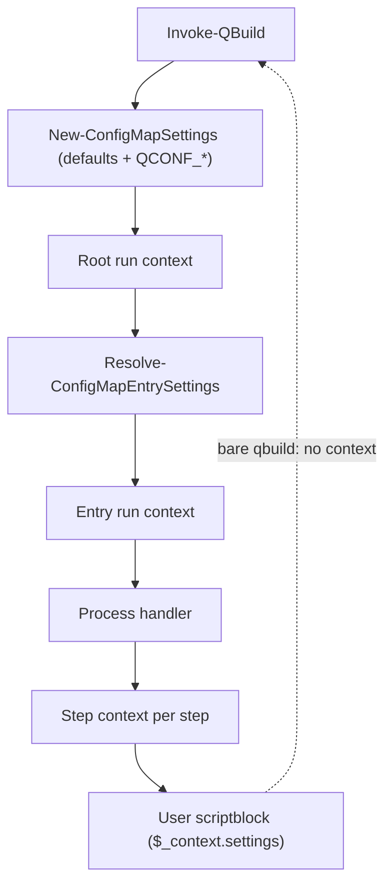

# Pass settings in a run context instead of module state

Effective settings live in one module variable, `$script:ConfigMapSettings` (`functions/settings.ps1`). `Invoke-WithEntrySettings` stacks a scope on top of whatever is current, runs a scriptblock, and restores the previous value. Settings therefore follow the dynamic call stack, not the map.

That leaks into nested runs. A `qbuild` called from inside a running entry starts from the caller's scope and inherits every setting the target map does not override, including `process`.

## Motivating bug

```powershell
[ordered]@{
    "outer" = [ordered]@{
        _settings = @{ process = "steps" }
        "step1" = @{
            exec  = { Write-Host "exec ran" }
            check = { qbuild inner; $true }
        }
    }
    "inner" = { Write-Host "inner ran" }
}
```

- `qbuild inner` works.
- `qbuild outer -check` fails: `MISSING step1 (Process 'inner' has no steps.)`
- Calling `qbuild inner` from the step's `exec` fails the same way: `FAIL step1 — Process 'inner' has no steps.`

`inner` has no `_settings.process`, so it keeps the caller's `steps` and is dispatched to the steps handler. The same leak applies to `UseWorkDir`, `ForceCheck`, `Concurrently`, `TmuxAutoWindow`, `DiscoveryCache*` and `Debug`.

## Current state

Readers of the global (all module-internal):

| Setting | Reader |
|---|---|
| `UseWorkDir` | `functions/invoke-entry.ps1` (`Invoke-EntryCommand`) |
| `ForceCheck` | `handlers/qrun/qrun.ps1` |
| `Debug` | `handlers/qconf/qconf.ps1` |
| `DiscoveryCache`, `DiscoveryCacheLocation` | `functions/discovery-cache.ps1` |
| `Concurrently` | `plugins/plugin-concurrently/concurrently.ps1` |
| `TmuxAutoWindow` | `plugins/plugin-tmux/tmux.ps1`, `_plugin.ps1` |
| all | `!settings` internal command |

Writers:

- `Invoke-WithEntrySettings`: `handlers/exec/exec.ps1`, `handlers/qrun/qrun.ps1`, `handlers/qrun/process-state.ps1`, `handlers/qconf/qconf.ps1`, `functions/invoke-entry.ps1`, `plugins/plugin-tmux/_plugin.ps1`.
- `Enter-ConfigMapSettingsScope`: four sites in `functions/discovery-cache.ps1`, wrapping map loading.

`Get-ConfigMapSettings`, `Enter-ConfigMapSettingsScope` and `Invoke-WithEntrySettings` are not exported. The public contract is the `_settings` schema, the `QCONF_*` environment variables and the `!settings` output; none of these change.

Context objects that already exist and overlap:

- `OperationContext`: include and dependency caches for one operation.
- `New-ConfigMapProcessContext`: handler input (`Map`, `Entry`, `BoundParameters`, passthrough arguments, `OperationContext`).
- Plugin hook contexts, built ad hoc in `Invoke-EntryWrapper` and `exec.ps1`.
- `$_context` for user scriptblocks: `self`, `base`, `workDir`, `mapDir`.

## Design

One run context per `qbuild` invocation. Each entry gets a child context. No module variable holds settings.

```powershell
@{
    Settings  = <ConfigMap.Settings>  # base, then map _settings, then ancestors, then the entry
    Operation = <OperationContext>    # caches; shared by reference between parent and child
    Map       = ...
    MapPath   = ...
    EntryKey  = ...
    Entry     = ...
    WorkDir   = ...
    MapDir    = ...
}
```



### Pure settings resolution

`Resolve-ConfigMapEntrySettings -Base -Map -EntryKey -Entry [-OperationContext]` returns a settings object and touches no state. It applies the map's `_settings`, the ancestor chain from `Find-ConfigMapAncestorSettings`, and the entry's own `_settings` on top of `-Base`, in the same order as today. `Get-ConfigMapSettingsForPath` (completion, help, list, `!settings`) becomes a wrapper around it.

### Child contexts replace scopes

```powershell
# before
Invoke-WithEntrySettings -Map $map -EntryKey $key -Entry $entry -OperationContext $op -ScriptBlock { ... }

# after
$child = New-ConfigMapEntryContext -Parent $context -EntryKey $key -Entry $entry
...  # pass $child explicitly
```

Nothing is mutated, so no `try`/`finally` is needed. A child's settings are resolved from the parent's base settings and the map, not from the parent's resolved settings, so a sibling or nested entry never sees another entry's `_settings`.

### Readers take settings explicitly

`Test-ConfigMapFeatureEnabled` and `Get-ConfigMapSetting` gain a mandatory `-Settings` parameter. Handlers read from `$Context.Settings`. Plugin hook contexts carry `Settings` and the run context instead of copied fields.

### User scriptblocks

`$_context.settings` exposes a read-only copy of the entry's effective settings. This is new, opt-in data; existing `$_context` keys stay.

### Nested qbuild

A nested `qbuild inner` inside a scriptblock receives no context. It starts from base settings and the target map's own `_settings`, which fixes the motivating bug. Nothing is inherited from the caller.

### Consolidation

- `OperationContext` becomes the `Operation` field of the run context.
- `New-ConfigMapProcessContext` carries the run context instead of `OperationContext`.
- Plugin hook contexts are built from the run context.

## Hard parts

- **Discovery cache.** It enters scopes around map loading, so settings must be threaded through the import path, including the `$script:ImportConfigMap` scriptblock. This is the most invasive step.
- **`exec` arrays.** `Invoke-EntryCommand` passes a sub-entry as `-Map` and relies on the parent's scope still being active. It needs the parent context instead.
- **`Invoke-EntryCommand` is exported.** It gets an optional `-Context`. Without one it resolves settings from the entry alone, which matches the nested-qbuild behavior.
- **Base settings are captured, not re-read.** `$script:ConfigMapBaseSettings` holds defaults plus `QCONF_*` as read at import; `Update-ConfigMapSettings` refreshes it. Tests rely on this (`settings.tests.ps1`: "uses the initialized settings object until explicitly refreshed"), so it stays.

## Migration

Each step keeps the suite green.

1. **Done.** Red regression tests in `qbuild-process.tests.ps1`: nested `qbuild` from a steps `exec` and a steps `check` runs the target as `exec`; a nested `qbuild` from a `useWorkDir` entry runs in its own map directory.
2. **Done.** `Resolve-ConfigMapEntrySettings` layers map, ancestor and entry `_settings` over `$script:ConfigMapBaseSettings`. `Get-ConfigMapSettingsForPath` uses it, which fixes dispatch: the steps tests go green.
3. **Done.** `Invoke-WithEntrySettings` resolves from the base and the map instead of stacking on the current settings, and installs the result only for its scriptblock. The `useWorkDir` test goes green. `exec`-array subcommands pass `-BaseSettings` with the parent's settings because they resolve against a sub-entry. The scope-stacking helpers are gone.

   This deviates from the original step 3 (thread a run context through every handler). With no inheritance, an entry's settings depend only on the base and the map, so the bug could be fixed without threading. The module variable remains as a bridge for readers.
4. **Done.** `functions/run-context.ps1` adds `New-ConfigMapRunContext`, `New-ConfigMapEntryContext`, `Invoke-WithRunContext` and `ConvertTo-ConfigMapReadOnlySettings`. `Invoke-QBuild`, `Invoke-QRun` and `Invoke-QConf` build a run context; the exec, steps and options handlers, `Invoke-EntryWrapper`, `exec` arrays and the tmux plugin pass child contexts down instead of calling `Invoke-WithEntrySettings`, which is removed. `Invoke-EntryCommand`, `Invoke-Set` and `Invoke-Get` take an optional `-RunContext`. Internal readers (`UseWorkDir`, `ForceCheck`, qconf `Debug`, the tmux and concurrently plugins) pass `-Settings` explicitly; hook contexts carry `Settings` and `RunContext`. Scripts get `$_context.settings` as a read-only dictionary.
5. **Done.** The discovery cache reads its settings from `Get-ConfigMapDiscoveryCacheSettings`: the base settings plus the map's `DiscoveryCache*` overrides. It no longer enters scopes on top of the current settings, so a map loaded while an entry runs ignores that entry's settings. No threading through the import path was needed. `Enter/Exit-ConfigMapSettingsScope` are removed.
6. **Done.** `$script:ConfigMapSettings` is kept as the current settings for scripts (see below). Only `Invoke-WithRunContext` and `Update-ConfigMapSettings` write it. `!settings` without a map reads `Get-ConfigMapBaseSettings`; the only other reader is the fallback context for callers that pass none, such as a script calling `Invoke-EntryCommand`.

### Current settings for scripts

Map files are dot-sourced inside the module, so map scriptblocks and plugin hooks can call the non-exported `Get-ConfigMapSetting` and get the running entry's settings. Existing tests rely on this (`settings.tests.ps1`: build, configuration and exec-subcommand scripts, and the `InvokeEntryWrapper` and `InvokeQBuildTargets` hooks), and so does `qbuild !settings` without a path. `Invoke-WithRunContext` therefore still installs the context's settings as the current settings while a script or hook runs.

Deleting `$script:ConfigMapSettings` would break that, so it stays as the current settings for scripts. Scripts and hooks may use either `Get-ConfigMapSetting` or `$_context.settings` / `$Context.Settings`; script access is not deprecated.

Steps 1–3 fix the bug and can ship alone. Steps 4–6 finish the cleanup.

## Decisions

- **No settings reach nested runs.** A nested `qbuild` always starts from base settings (defaults + `QCONF_*`) and the target map. There is no `-Context` passthrough; to change a nested run's settings, set `_settings` in its map or a `QCONF_*` variable.
- **`$_context.settings` is a read-only copy.** Scriptblocks get a snapshot; changing it does not affect the run context or later steps.
- **Standalone `qrun`/`qconf` are out of scope.** They are legacy; the external CLI handoff keeps its current behavior and does not receive the context.
