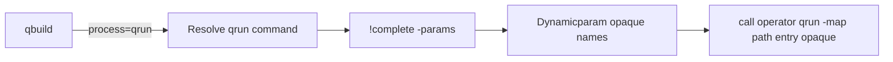

# Process CLI contract (command-level)

## Decision

Map handoff is **path-only**: qbuild passes `-map <file>`. The process command must
load and understand that map format itself. No JSON materialization from qbuild.

Invocation is via the PowerShell call operator (`&`), not `Start-Process` / raw
shell spawn.

Flag style is **single-dash only** (PowerShell-friendly). No `--long` forms.

**qbuild must not hardcode process-specific switches** (`-Follow`, `-Force`,
`-Status`, `-Reset`, step params, etc.). Those are owned by the process command.
qbuild discovers them (via `!complete`) for autocomplete / dynamicparam, then
forwards them **opaquely** in the argv to `& <process> ...`.

Implication: in-memory maps used in tests must be written to a temp file before
`&` invoke (implementation detail later).

## Layering: what qbuild knows vs what is opaque

```mermaid
flowchart TD
  qbuild[qbuild] --> known["Known contract: -map, entry path, list, !complete"]
  qbuild --> opaque["Opaque argv: discovered process params"]
  known --> call["call operator process args"]
  opaque --> call
  call --> proc[process command e.g. qrun]
```

| Layer | Examples | qbuild behavior |
|-------|----------|-----------------|
| Shared contract | `-map`, `<entry>`, `list <entry>`, `!complete …` | May construct these intentionally |
| Process-owned | `!state`, `help`, `-Follow`, `-Force`, `-Status`, `-Reset`, `-Environment`, … | Discover + forward only when user-supplied; never special-case on `Invoke-QBuild` |

`!state` is **not** a qbuild builtin. Status in `qbuild list` uses `list <entry>`.
Show/clean of persisted state is done via the process directly (`qrun !state …`).

**Later (out of scope now):** qbuild may grow a generic escape for process
specials, e.g. `qbuild !state …` → `& <process> !state …` when the
current/default process supports it. Not required for the v1 contract.

Remove `-Follow` / `-Force` / `-Status` / `-Reset` from `Invoke-QBuild`’s param
block when implementing (revert the earlier in-process splat design).

## Discovery

| Item | Rule |
|------|------|
| Entry setting | `process = "<name>"` (default `qbuild` = built-in, not delegated) |
| Command | Resolve `<name>` via PATH / command discovery so `& <name> ...` works |
| Plugin folder | Optional metadata later (`plugins/process-<name>`); not required if command resolves |
| Working directory | Inherit qbuild’s current directory |
| Environment | Inherit process env; no required `CONFIGMAP_*` vars in v1 |

## Required CLI surface (shared contract)

A process command MUST support the following. Flag style is single-dash.

### Global

```text
<process> [-map <path>] <command-or-entry> [opaque-args...]
```

- `-map` — path to map file (required when not using the tool’s default map path)
- Success: exit `0` / no throw; failure: non-zero exit or terminating error from `&`
- Human-oriented stdout/stderr; qbuild does not parse stdout for control flow in v1

### Run entry

```text
<process> [-map <path>] <entry> [opaque-args...]
<process> [-map <path>] <entry>.<step> [opaque-args...]
<process> [-map <path>] <entry>.all [opaque-args...]
```

qbuild builds argv as: command name, optional `-map <path>`, entry string, then
**opaque** bound/remaining arguments exactly as the user supplied them (order
preserved as far as PowerShell binding allows).

### List / status for one entry (qbuild list integration)

qbuild-known verb (not a process-specific switch on qbuild itself):

```text
<process> [-map <path>] list <entry>
```

MUST print that entry’s status/summary (for qrun: same tree as today’s `-Status`
/ `!state show <entry>`).
qrun may still expose `-Status` to end users when invoked directly; qbuild list
does not pass `-Status` — it calls `list <entry>`.

### State command (process-owned; not used by qbuild)

Optional for processes that keep durable state. Invoked by users directly
(e.g. `qrun !state`), not by qbuild:

```text
<process> [-map <path>] !state
<process> [-map <path>] !state show [<entry>]
<process> [-map <path>] !state clean [<entry>]
```

### Help (process-owned; not used by qbuild)

```text
<process> help
```

### Completion / param discovery (machine-readable)

Entry / token completion:

```text
<process> [-map <path>] !complete -word <prefix> [-entry <current-entry>]
```

Stdout: one candidate per line. Exit `0`.
Unsupported: exit `2` → qbuild falls back to map-only `Get-EntryCompletion`.

Parameter discovery (names for autocomplete + dynamicparam; values remain opaque):

```text
<process> [-map <path>] !complete -params -entry <entry>
```

Stdout: one parameter name per line **without** leading `-` (e.g. `Follow`,
`Force`, `Environment`). Exit `0`, or `2` if unsupported.

qbuild uses this list to expose dynamic parameters for the current entry; it does
not interpret their meaning. When invoking, it forwards whatever the user bound
(e.g. `-Follow`, `-Environment prod`) as opaque argv.

## How qbuild uses each shared command

| Command | qbuild trigger | `&` argv |
|---------|----------------|----------|
| **Run** | `qbuild bootstrap` / `qbuild bootstrap.prepare -Follow` | `qrun -map <file> bootstrap.prepare -Follow` |
| **List entry** | `qbuild list` row for `process=qrun` | `qrun -map <file> list bootstrap` |
| **Complete tokens** | Tab on entry | `qrun -map <file> !complete -word <prefix> …` |
| **Complete params** | Tab / dynamicparam after entry | `qrun -map <file> !complete -params -entry …` |

## Process-owned options (informative: qrun)

Not part of what qbuild hardcodes. Documented so `qrun` (and clones) stay
consistent when called **directly**:

| Flag | Meaning (qrun) |
|------|----------------|
| `-Follow` | With a step path, also run following steps |
| `-Force` | Rerun succeeded steps; allow mid-start when priors incomplete |
| `-Status` | Print step status; do not run |
| `-Reset` | Clear persisted state for the process |

These SHOULD appear in `!complete -params` for relevant entries so
`qbuild bootstrap -<Tab>` offers them.

## What is out of contract (qbuild-owned)

- Built-in `process=qbuild` (in-process runner / regular plugins)
- Parsing `.ps1` maps for non-PS tools
- Regular plugin hooks when delegated
- Semantic knowledge of Follow/Force/Status/Reset

## Reference mapping

| qbuild action | `&` argv |
|---------------|----------|
| `qbuild -map f bootstrap -Force` | `qrun -map f bootstrap -Force` (Force opaque) |
| `qbuild -map f bootstrap.prepare -Follow` | `qrun -map f bootstrap.prepare -Follow` |
| `qbuild list` (bootstrap row) | `qrun -map f list bootstrap` |
| autocomplete params | `qrun -map f !complete -params -entry bootstrap` |

## Later implementation sketch



- Strip `-Follow/-Force/-Status/-Reset` from `Invoke-QBuild`
- Replace in-process `Invoke-QRun` in process plugin with `& $command @argv`
- Wire dynparam/completer to `!complete`
- Adjust `test/qbuild-process.tests.ps1` per below before or with the switch

## Existing tests vs new contract

File: `test/qbuild-process.tests.ps1`

**Verdict:** scenarios are mostly right; setup and some assertions are tied to
today’s in-process forwarder and will need updates.

### Likely keep working (behavioral via `qbuild`)

- Default qbuild entry still runs
- Full process run + state under `.configmap/process`
- Skip / `-Force` / step path / `-Follow` / prior-step gate
- `-Environment prod` end-to-end
- Sample smoke (already file-backed after copy)

These assert markers, state JSON, and error messages — not how qbuild reaches qrun.

### Need changes for `&` + path-only + opaque args

| Area | Current test | Problem | Direction |
|------|--------------|---------|-----------|
| Map handoff | Almost all use `-map $hashtable` | Contract is path-only; `& qrun -map` needs a file | Write temp `.build.map.ps1` in `BeforeEach` (or serialize hashtable to temp file) |
| `!state` | `supports qbuild !state show and clean` | `!state` is not a qbuild builtin anymore | Remove; cover via `qrun !state` if needed |
| Dynparams | `Get-ProcessDynamicParam` in `InModuleScope` | Couples to qrun internals | Assert via `!complete -params` and/or real `qbuild … -Environment` bind |
| List | `Write-MapHelp` + Mock `Write-Host` / `Write-ProcessStatus` | List becomes `& qrun list <entry>` | Drive `qbuild list` (or assert `list` argv); don’t call in-process status helpers |
| Completion | `Get-EntryCompletion` only | May still pass via map walk; misses process `!complete` | Add/adjust for `!complete -word` path when wired |
| Opaque switches | `-Follow` / `-Force` on `qbuild` | Works today because qbuild declares those params | Keep behavioral tests; rely on dynparam discovery + opaque forward, not hardcoded qbuild switches |

### Standalone `qrun.tests.ps1`

Unaffected by the qbuild↔process contract switch (still exercises `Invoke-QRun`
directly). Keep green as a regression suite for the process implementation itself.

## Todos

- [x] Keep this contract doc as the normative reference
- [x] When implementing: update `qbuild-process.tests.ps1` for file `-map`, drop `qbuild !state`, abstract list/complete/dynparam
- [x] Strip hardcoded process switches from `Invoke-QBuild`; delegate via `&` + `!complete`
