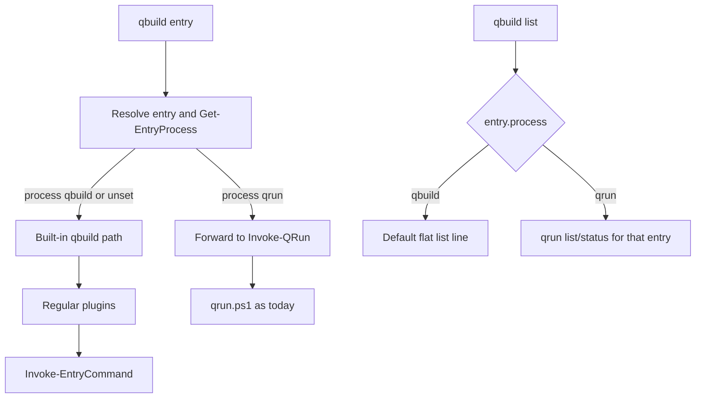

# Merge qrun into qbuild via process forwarding

## Goal

Entries may declare which runner owns them:

```powershell
"bootstrap" = [ordered]@{
    process     = "qrun"   # default if omitted: qbuild
    description = "Bootstrap workspace"
    "prepare"   = { ... }
    "restore"   = { ... }
}
```

- `qbuild bootstrap` with `process=qrun` **forwards** to `qrun bootstrap` (same map, same args)
- Argument completion / dynamic params for those entries also forward to qrun
- `qbuild list`, when it hits a `process=qrun` entry, forwards to qrun list/status for that entry
- `qrun.ps1` stays the real implementation; process plugin is a thin forwarder
- `qrun` CLI remains usable standalone on `.process.map.ps1`

## Approach: test-driven

Work in this order. Do not implement forwarding until the red baseline exists.

### Phase 1 — Mixed sample map

Add `samples/process-mixed/`:

- `.build.map.ps1` — single map mixing:
  - Normal qbuild entries (scriptblock / `exec`) e.g. `clean`, `build`
  - At least one `process = "qrun"` entry with ordered steps (e.g. `bootstrap` with
    `prepare` → `restore` → `verify`), marker-file style like `test/qrun.tests.ps1`
  - Optional second qrun process if useful for `!state` filtering
- Short `README.md` describing `qbuild build` vs `qbuild bootstrap` vs `qbuild list`

Sample steps should be deterministic and filesystem-based so Pester can assert
artifacts and `.configmap/process/**/*.state.json` without mocks.

### Phase 2 — Pester tests (expect fail / red)

Add `test/qbuild-process.tests.ps1` (name flexible). Prefer **in-memory maps** in
`BeforeEach` (same style as `qrun.tests.ps1`) for unit speed; optionally one
smoke test that loads `samples/process-mixed/.build.map.ps1`.

Cover the important flows through **`qbuild`**, not `qrun` directly:

| Area | Example assertions |
|------|--------------------|
| Default path unchanged | `qbuild -map $map build` still runs plain exec entry |
| Forward full process | `qbuild -map $map bootstrap` runs all steps, writes state JSON |
| Skip succeeded | Re-run skips; markers for later steps stay absent if deleted |
| `-Force` | Re-runs succeeded steps |
| Step path | `qbuild bootstrap.prepare` runs one step |
| `-Follow` | `qbuild bootstrap.restore -Follow` continues through later steps |
| Prior-step gate | Mid-start without priors throws unless `-Force` |
| Completion | `Get-EntryCompletion` (and/or qbuild completer) includes qrun step paths under the process root |
| Dynamic params | Step `param()` blocks surface when invoking via qbuild (if sample has typed params) |
| List / status | `qbuild list` (or captured host output) shows status tree for `process=qrun` entries; flat line for normal entries |
| `!state` | `qbuild !state` / `!state show bootstrap` / clean behave via forward |

Reuse patterns from `test/qrun.tests.ps1` (markers, state file read) and
`test/qbuild.tests.ps1` (completion via `Get-EntryCompletion`).

### Phase 3 — Baseline (red)

```powershell
Invoke-Pester -Path test/qbuild-process.tests.ps1
```

Record which cases fail (expected until forwarding exists). Also run
`test/qrun.tests.ps1` to confirm standalone qrun is still green (no regressions
from sample-only changes).

### Phase 4 — Implement (green)

Implement the forwarding design below until `qbuild-process.tests.ps1` passes.
Re-run `qrun.tests.ps1` + targeted qbuild tests after.

## Architecture (implementation target)



### Process plugin (thin forwarder)

- `src/plugins/process-qrun/_process.ps1` — adapter only; does not own the runner
- Loader + `Get-EntryProcess` / `Get-ConfigMapProcess` /
  `Resolve-ConfigMapProcessRoot` in core
- Reserved key `process` on build language
- `Invoke` → `Invoke-QRun -entry … -map <same map> @switches`
- Completion / `GetDynamicParam` → existing qrun helpers
- List → scoped status (`Write-ProcessStatus` / `!state show <name>`)
- Optional `qbuild !state` → forward to `qrun !state` with same map
- qbuild gains `-Follow/-Force/-Status/-Reset` for splat-through; ignored on
  built-in path

### What stays put

- `qrun.ps1` and `process-state.ps1` remain the implementation
- Standalone `qrun` on `.process.map.ps1` unchanged (process implied)

## Implementation order (after red baseline)

1. Reserved key + process registry/loader + resolve helpers
2. Thin `process-qrun` forwarder to `Invoke-QRun`
3. qbuild invoke dispatch + switches + map passthrough
4. Completion / dynamicparam forwarding
5. Scoped list/status in `Write-MapHelp`
6. `qbuild !state` forward
7. Re-run tests to green; fix gaps

## Todos

- [x] Add `samples/process-mixed/.build.map.ps1` (+ README) mixing qbuild + process=qrun entries
- [x] Add `test/qbuild-process.tests.ps1` covering forward/skip/force/follow/completion/list/state
- [x] Run new tests for red baseline; confirm `qrun.tests.ps1` still green
- [x] Implement process reserved key, loader, thin process-qrun forwarder
- [x] Wire qbuild dispatch, switches, completion, list, !state
- [x] Re-run tests to green; keep existing qrun/qbuild suites passing
